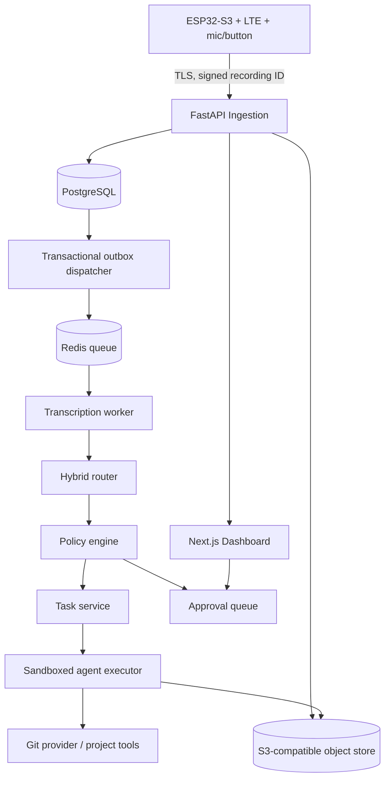

# VOX Agent — Product Requirements Document
**Version:** 0.2 draft · **Date:** 2026-10-19 · **Status:** approved design direction; engineering validation pending

## 1. Executive summary
VOX Agent is a standalone push-to-talk pocket device that transmits spoken instructions over cellular data to a self-hosted backend. The backend transcribes the audio, assigns it to an existing project or creates one, and dispatches a durable task to an autonomous AI agent. A dashboard gives the owner visibility, controls, correction and auditability.

**Decisions fixed:** extended autonomous execution with configurable grants (`full`); hybrid deterministic/semantic/LLM project routing; own backend on VPS; ESP32-S3 + LTE Cat 1 bis (no Wi-Fi dependency in production).

**Definition of standalone:** the device does not require a phone or Wi-Fi to capture and submit work. Model inference, repository operations, storage and agents run on server-side infrastructure; cellular coverage and internet service remain necessary. Offline capture queues locally.

## 2. User story & scope
Primary user: solo developer/creator managing several coding, research and product projects.

Key use cases:
- “En Musiquillas, implementa partidas con amigos y crea una PR”.
- “Crea un proyecto llamado X, investiga la idea y prepara el repositorio”.
- “Retoma la tarea de ayer en el proyecto de hardware”.
- “Apunta esta idea, no ejecutes nada”.
- “Publica la versión si pasa los tests” (must obey scoped deployment authorization).

In scope (MVP): one user and registered devices, Spanish voice, cellular upload, basic hybrid routing with correction, projects/tasks/runs, GitHub-compatible executor adapter, tool permission policy, approvals, web dashboard, observability and durable queues.

Out of scope (MVP): voice assistant conversation with synthesized speech, on-device STT/LLM, multiuser billing, physical product certification, firmware OTA rollout at scale, universal desktop control, indefinite agent self-direction, unrestricted remote shell.

## 3. Goals & measurable targets (engineering hypotheses)
| ID | Metric | MVP target and verification |
|---|---|---|
| G1 | Capture success | >=99% for 30-sec recordings on functioning hardware; 100 repeated local tests |
| G2 | Backend receipt | >=99% uploads within 60s under validated LTE signal; 100 field trials; exclude outages |
| G3 | Routing | >=95% correct among explicit project references on 100 labeled test utterances; ambiguous cases abstain |
| G4 | Duplicate tasks | 0 duplicate tasks from 100 retransmissions of same idempotency key |
| G5 | Security | 0 high-risk privileged side effects without matching active grant or approval in policy integration tests |
| G6 | Traceability | 100% of tasks expose transcript, route decision, run, result and audit trail |
| G7 | E2E readiness | User can create project and produce a draft PR from voice using staging setup |

Targets are acceptance goals, **not** measured system performance. Optimize P50/P95 queue-to-task timing after instrumentation.

## 4. Functional requirements
- **FR-01** Push-to-talk: hold to capture; release to finalize; maximum configurable duration (default 90s); LED state and optional haptic confirmation.
- **FR-02** Offline-first delivery: assign recording UUID on device, persist audio + metadata until server acknowledges durable receipt, retry with exponential backoff and jitter; user-visible queue-full condition.
- **FR-03** LTE: modem provisioning with supported APN/SIM; HTTPS TLS validation; optional fallback operator profile if hardware supports it.
- **FR-04** Audio: mono 16 kHz 16-bit PCM WAV initially; compressed format is optional and must be validated end-to-end before enablement. Recordings must have checksum and duration.
- **FR-05** Ingestion: pre-authorized device upload, explicit quota, size/duration caps, idempotency, object store, asynchronous processing.
- **FR-06** STT: pluggable provider; Spanish-first, multilingual extensibility; save transcript and confidence/metadata if available; provide project glossary.
- **FR-07** Hybrid router: explicit project mention/alias exact match → semantic candidates → LLM structured decision; no automatic creation on uncertain intents; candidate/explanation persisted.
- **FR-08** Continuations: resolve references (“ayer”, “sigue con esto”) from user's recent tasks/projects; abstain when context insufficient.
- **FR-09** Projects: create, archive, assign Git repository, maintain project description, aliases, context snapshots and environment restrictions.
- **FR-10** Tasks: create durable task with payload, run-mode, budget, trace ID, source recording and parent task references; review and change routing decisions.
- **FR-11** Runs: start/stop/retry agent jobs; sandboxed execution, repo worktree/branch per run; output logs, artifacts and PR URL; no direct commits to protected branches by default.
- **FR-12** Permission system: per-user/project/agent tool capability grants, risk classification, deadline and spend ceiling, explicit approval for actions exceeding policy. “Full” means expanded *configurable* capabilities, not bypassing approval.
- **FR-13** Dashboard: recordings, transcripts, tasks, statuses, router corrections, run events/logs, approvals, policy settings, device state.
- **FR-14** Audit: append-only action records (actor, resource, tool, arguments digest, policy decision, timestamp, outcome) and cost usage.
- **FR-15** Cancellation: cancellation is best-effort for in-flight tools; no assumption that external side effects can be rolled back.

## 5. Non-functional requirements
- **NFR-01** Security: HTTPS only; TLS certificate verification; per-device credential; revocation; no secrets in firmware logs; secrets manager or Docker secrets on backend.
- **NFR-02** Data: Postgres for durable structured data, object storage for audio/artifacts, Redis for dispatch only; queue messages carry references not entire audio.
- **NFR-03** Isolation: containerized executor with non-root user, scoped filesystems, CPU/RAM/time quotas, restricted egress, no host Docker socket.
- **NFR-04** Reliability: transactional outbox for events; at-least-once message delivery; deduplication at task + effect boundary; dead-letter queue.
- **NFR-05** Cost: per-task budgets, global daily limits, approval on projected overrun; track actual model/tool tokens and money.
- **NFR-06** Privacy: audio retention default 7 days, transcript 90 days unless user config changes; deletions propagate to object store; backup policy documented.
- **NFR-07** Observability: structured JSON logs, correlation IDs, metrics, alerts for failed queue jobs and excessive spending.
- **NFR-08** Firmware: no mandatory Wi-Fi; sleep/awake behavior measured; brownout protection for modem power peaks.
- **NFR-09** API versioned at `/v1`; migrations backwards compatible for at least one deployed firmware release.

## 6. Logical architecture

All requests and jobs propagate `trace_id` and `user_id`. Routers do not themselves execute tools. Sandbox worker fetches short-lived scoped credentials through approved server-side broker.

## 7. Event-driven lifecycle
**Recording states:** `pending_upload → stored → transcribing → transcribed → routing → routed | needs_review | failed`.  
**Task states:** `draft → queued → running → waiting_approval → completed | failed | cancelled`.  
**Run states:** `queued → provisioning → running → waiting_approval → succeeded | failed | cancelled | timed_out`.

Transitions must be server-validated; terminal states are immutable except explicit retry (new run, same task). A stored recording's upload acknowledgment is emitted after object persistence and database commit, never after merely opening a connection.

**Events:** `recording.stored.v1`, `transcript.ready.v1`, `routing.decided.v1`, `task.created.v1`, `run.started.v1`, `approval.requested.v1`, `run.finished.v1`. Envelope: `{event_id, event_type, schema_version, occurred_at, trace_id, aggregate_id, payload}`.

## 8. Hybrid routing design
1. Normalize transcript (case/diacritics) only for candidate lookup; retain original text.
2. Detect explicit instructions such as “proyecto X”, “proyecto nuevo”, “solo anota”, negations; exact match unique project IDs/aliases.
3. Retrieve top 5 semantic candidate projects from descriptions, tags and last task abstracts (pgvector optional; start with Postgres full-text/trigram and upgrade).
4. LLM constrained JSON: intent, project_id/null, new project title, task title, suggested agent, confidence, rationale, requires_review.
5. Validator checks project existence/ownership and policy, applies thresholds calibrated on labeled dataset; abstain for conflicting signals or destructive ambiguity.
6. Persist decision with ranked candidates, routing model version and feedback.
7. Corrected decisions are re-routable; do not retroactively move a running task without explicit cancellation and review.

Initial suggested thresholds: explicit unique reference = route if no conflicting instruction; LLM confidence >=0.90 and clear semantic margin for autonomous routing, 0.65–0.90 review, below 0.65 unclassified. These are placeholders to calibrate, not statistical guarantees.

## 9. Execution and authorization model
Capabilities: `repo.read`, `repo.write_branch`, `repo.open_pr`, `ci.run`, `deploy.staging`, `deploy.production`, `network.http`, `issues.write`, `message.send`, `secrets.read_scoped`, `shell.sandboxed`.

Default grants: read, isolated branch edits, tests, draft PR. The `full` mode allows issuing additional grants such as production deploys, external messages and workflows, each scoped by project, target, expiry and limits. High-risk actions require explicit per-action approval unless owner intentionally configures an appropriately scoped standing grant; irreversible/destructive operations remain outside automation by default.

Policy decision must run at tool invocation, not just at task creation. Tool broker stores idempotency/effect key before dispatching an external request; if outcome is unknown, mark `needs_reconciliation` rather than blindly replaying.

Prompt content/transcripts/repository files are untrusted instructions, never permission grants. All actions checked against the server-side permission policy. No arbitrary host shell or production secret exposure to agent containers.

## 10. Device/firmware profile
ESP32-S3 + digital I2S MEMS mic + push button + LTE Cat 1 bis modem + battery + charger/power path + flash storage + LED. ESP-IDF I2S supports standard/PDM audio for ESP32-S3. Source: https://documentation.espressif.com/projects/esp-idf/en/latest/esp32s3/api-reference/peripherals/i2s.html

Device FSM: `SLEEP → RECORDING → BUFFERED → CONNECTING → UPLOADING → ACKED → SLEEP`; errors: `NO_SIGNAL`, `TLS_FAILURE`, `STORAGE_FULL`, `BATTERY_LOW`, `SERVER_REJECTED`.

- Upload a single WAV file at first; segment resumable upload only if field tests warrant it.
- Use `recording_id` UUID and SHA-256 digest generated on device. Persist `recording_id`, payload and attempt counter atomically.
- Register device using one-time bootstrap token over trusted interface; rotate credentials with re-enrollment workflow.
- Design power rail for modem TX current peaks based on actual module hardware design guide; do not assume ESP32 regulator can drive modem.
- Validate network support in Spain / intended travel regions, APN setup, SIM roaming, carrier NAT and fallback bands before PCB design.
- Hardware size and battery life remain **unvalidated** until modem sleep, antenna and firmware profiling tests.

## 11. API behavior and errors
JSON responses for control plane; binary upload `audio/wav` for audio body. Standard problem response: `{code,message,trace_id,details?}`. HTTP 401 bad auth, 403 disallowed, 404 absent/hidden resource, 409 incompatible transition or duplicate conflict, 413 too large, 422 validation, 429 rate/budget limit, 503 transient.

`Idempotency-Key` is mandatory for mutating task/run/approval endpoints; recording upload idempotency uses its path ID plus checksum. 201 on first create, 200 on replay with same body, 409 on collision with different content. All timestamps ISO-8601 UTC.

## 12. Deployment & operations
Self-host with Docker Compose for single-node MVP (Caddy/Traefik, FastAPI, worker, Postgres, Redis, MinIO, dashboard). Put object store and DB on backed-up volumes, expose only reverse proxy, isolate containers on separate networks, enable monitoring and encrypted backups; scale to orchestration only after performance data. CI: lint, unit, contract, migration, security and staged end-to-end checks.

## 13. Acceptance scenarios
1. Upload same recording twice with same ID/digest → one recording and one downstream task.
2. Explicit project match → correct project task, visible in dashboard.
3. Unknown project plus “crea proyecto nuevo” → new project in draft state, no unapproved external repository creation unless grant exists.
4. “No lo ejecutes” → capture-only, no run.
5. Ambiguous “lo de ayer” → pending review, no agent.
6. LTE loss mid-upload → local retry without duplicate server-side execution.
7. Agent requests `deploy.production` without grant → waits for approval and emits audit record.
8. Same external effect retried after timeout → broker blocks blind repeat and records reconciliation state.
9. Agent timeout/cancel → execution stops where possible; prior external effects appear in audit.
10. Token budget reached → stop or request explicit extension.

## 14. Open risks & decisions to resolve
- LTE module specific part, regional bands, SIM price and roaming policy.
- Whether preauthorized production deployment is permissible for each project, and what approval UX is used.
- Audio compression vs initial WAV data costs.
- Execution backend choice (Codex adapter, subprocess tools, or custom) and Git provider integration.
- Hardware secure boot/flash encryption/recovery and eventual OTA policy.
- Router benchmark dataset, multilingual names and confidence calibration.

## 15. Milestones
**M0 contract freeze:** schema, OpenAPI, event envelopes, fixture recordings, policy matrix.  
**M1 backend vertical slice:** upload → STT → route → task → sandboxed fake agent → UI.  
**M2 real agent integration:** Git branch/PR + tool broker + audit/approvals.  
**M3 cellular hardware:** end-to-end LTE and retransmission testing.  
**M4 reliability/hardening:** security, budgets, battery and coverage trials.

## 16. Sources
- Espressif ESP32-S3 I2S documentation: https://documentation.espressif.com/projects/esp-idf/en/latest/esp32s3/api-reference/peripherals/i2s.html
- FastAPI OpenAPI documentation: https://fastapi.tiangolo.com/reference/openapi/docs/
- PostgreSQL RLS documentation: https://www.postgresql.org/docs/current/ddl-rowsecurity.html
